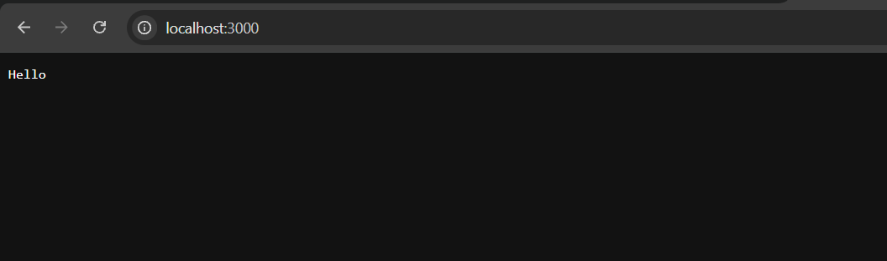
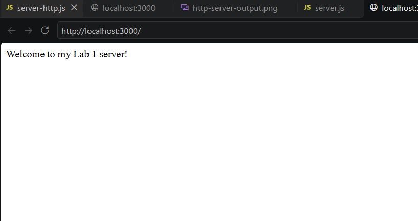
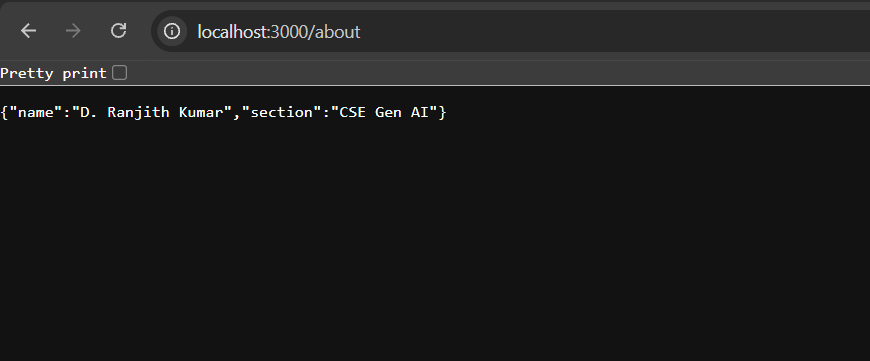
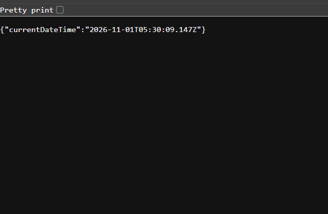
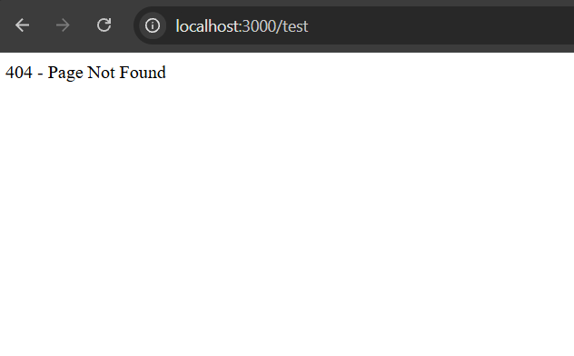

# LAB 01: Creating a Basic HTTP Server and Express Server Using Node.js

## 1. Aim

To understand the fundamentals of backend development by setting up Node.js, creating a basic HTTP server using the built-in HTTP module, and developing an Express.js server with multiple routes and appropriate HTTP status codes.

## 2. Objectives

- To understand the basics of Node.js.
- To initialize a Node.js project using npm.
- To create a basic HTTP server using the built-in HTTP module.
- To install and use the Express.js framework.
- To implement multiple GET routes.
- To understand HTTP response status codes such as 200 and 404.
- To test server responses using a web browser.

## 3. Software and Tools Required

| Tool | Purpose |
|---|---|
| Node.js | JavaScript runtime environment |
| npm | Package management |
| Express.js | Backend web framework |
| Visual Studio Code | Code editor |
| Google Chrome | Testing server routes |
| Windows Terminal | Executing commands |

## 4. Introduction

Backend development is an important part of web application development. It handles server-side operations, processes client requests, and sends responses to users.

Node.js is a JavaScript runtime environment that allows JavaScript to execute outside the browser. It provides built-in modules such as HTTP for creating web servers.

Express.js is a lightweight web framework built on Node.js. It simplifies server development by providing routing and request-response handling features.

In this experiment, a basic HTTP server was created first, followed by an Express server containing Home, About, Time, and Unknown routes.

## 5. Experience (Class Content)

During this experiment, I learned how to set up a Node.js backend development environment using Visual Studio Code.

First, I initialized a Node.js project using the npm command. Then, I installed Express.js and created a basic HTTP server using the built-in HTTP module.

After successfully running the HTTP server, I developed an Express application with different GET routes. Each route was tested using Google Chrome through localhost.

I also observed how the server responds to valid and invalid URLs.

## 6. Procedure / Implementation

### Step 1: Initialize the Node.js Project

The following command was executed in the terminal:

```bash
npm init -y
```

This command created the package.json file containing project information.

### Step 2: Install Express.js

```bash
npm install express
```

This command installed Express.js and its required dependencies.

### Step 3: Create the HTTP Server

A file named `server-http.js` was created.

The built-in HTTP module was imported to create a basic server.

### Step 4: Execute the HTTP Server

```bash
node server-http.js
```

The server started successfully at:

`http://localhost:3000`

### Step 5: Create the Express Server

A file named `server.js` was created to implement the Express application.

The following routes were implemented:

- `/` – Displays the welcome message.
- `/about` – Displays student details in JSON format.
- `/time` – Displays the current date and time.
- `/test` – Displays a 404 error message.

### Step 6: Execute the Express Server

```bash
node server.js
```

The Express server started successfully at:

`http://localhost:3000`

## 7. Source Code – Basic HTTP Server

File: `server-http.js`

```javascript
const http = require("http");

// Create HTTP server
const server = http.createServer((request, response) => {

    response.writeHead(200, {
        "Content-Type": "text/plain"
    });

    response.end("Hello");

});

// Start server
server.listen(3000, () => {
    console.log("HTTP server running at http://localhost:3000");
});
```

### Explanation

- `require("http")` imports the built-in HTTP module.
- `http.createServer()` creates a new HTTP server.
- `response.writeHead(200)` sends the HTTP success status.
- `response.end("Hello")` sends the response to the browser.
- `server.listen(3000)` starts the server on port 3000.

## 8. Source Code – Express Server

File: `server.js`

```javascript
const express = require("express");

const app = express();
const PORT = 3000;

// Home route
app.get("/", (request, response) => {
    response.status(200).send("Welcome to my Lab 1 server!");
});

// About route
app.get("/about", (request, response) => {
    response.status(200).json({
        name: "D. Ranjith Kumar",
        section: "CSE Gen AI"
    });
});

// Time route
app.get("/time", (request, response) => {
    response.status(200).json({
        currentDateTime: new Date()
    });
});

// Unknown route
app.use((request, response) => {
    response.status(404).send("404 - Page Not Found");
});

// Start server
app.listen(PORT, () => {
    console.log(`Express server running at http://localhost:${PORT}`);
});
```

### Explanation

- `require("express")` imports Express.js.
- `express()` creates an Express application.
- `app.get()` defines GET routes.
- `response.status(200)` indicates a successful request.
- `response.json()` sends data in JSON format.
- `app.use()` handles requests to undefined routes in this application.
- `response.status(404)` indicates that the requested resource was not found.
- `app.listen()` starts the Express server.

## 9. Output Screenshots

### Experiment 1: Basic HTTP Server Output

The HTTP server was executed successfully and displayed the message Hello in the browser.



### Experiment 2: Home Route

The Home route displayed the welcome message.



### Experiment 3: About Route

The About route returned student details in JSON format.



### Experiment 4: Time Route

The Time route returned the current date and time in JSON format.



### Experiment 5: Unknown Route

The application displayed a 404 Page Not Found message for an undefined route.



## 10. Learning Outcomes

After completing this experiment, I learned:

1. How to install and configure Node.js.
2. How to initialize a backend project using npm.
3. How to create a server using the built-in HTTP module.
4. How to install and use Express.js.
5. How to implement GET routes in an Express application.
6. How to return JSON responses.
7. How to use HTTP status codes 200 and 404.
8. How to test backend applications using a browser.

## 11. Feelings and Reflection

Initially, I found it challenging to understand how backend servers work and how to execute JavaScript files using the terminal.

After creating the HTTP server, I felt more confident because I could see the output directly in the browser. Implementing the Express routes helped me understand how different URLs generate different responses.

Testing the About and Time routes improved my understanding of JSON responses. The 404 route also helped me understand how applications handle invalid requests.

Overall, this experiment improved my practical knowledge of Node.js and Express.js.

## 12. Problems Faced and Solutions

| Problem | Solution |
|---|---|
| Understanding the project setup | Used `npm init -y` to initialize the project. |
| Installing Express.js | Executed `npm install express`. |
| Running the HTTP server | Used `node server-http.js`. |
| Testing the About route | Opened the correct URL `/about`. |
| Viewing JSON output | Used the browser's Pretty print option. |
| Testing undefined routes | Opened `/test` to verify the 404 response. |

## 13. Viva Questions and Answers

**Q1. What is Node.js?**

Node.js is a JavaScript runtime environment that allows JavaScript to run outside a web browser.

**Q2. What is npm?**

npm stands for Node Package Manager. It is used to install and manage project dependencies.

**Q3. What is Express.js?**

Express.js is a lightweight web framework used to build web servers and backend applications using Node.js.

**Q4. What is the HTTP module?**

The HTTP module is a built-in Node.js module used to create HTTP servers and handle requests and responses.

**Q5. What is a route in Express.js?**

A route defines how an application responds to a particular URL and HTTP method.

**Q6. What is the purpose of app.get()?**

It defines a route that handles HTTP GET requests.

**Q7. What does HTTP status code 200 mean?**

It means the request was successful.

**Q8. What does HTTP status code 404 mean?**

It means the requested resource or page was not found.

**Q9. What is JSON?**

JSON stands for JavaScript Object Notation. It is a lightweight data format used to exchange information.

**Q10. What is localhost?**

Localhost refers to the computer on which the server is running.

## 14. Application of Learning

The concepts learned in this experiment can be applied when developing backend services, REST APIs, web applications, and server-side systems.

Understanding Node.js and Express.js provides a foundation for developing more advanced backend applications with databases, authentication, and API integration.

## 15. Conclusion

In this experiment, I successfully created a basic HTTP server using Node.js and developed an Express.js server with multiple GET routes.

I tested the Home, About, Time, and Unknown routes using Google Chrome. The server returned the expected responses, including HTTP status codes 200 and 404.

This experiment helped me understand the fundamentals of backend development and improved my practical knowledge of Node.js and Express.js.
